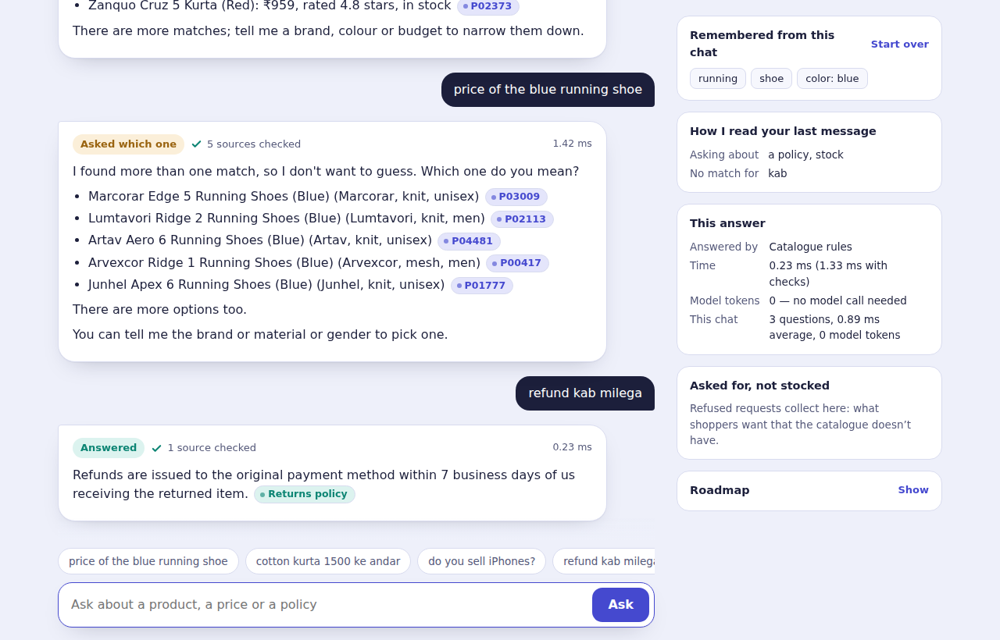
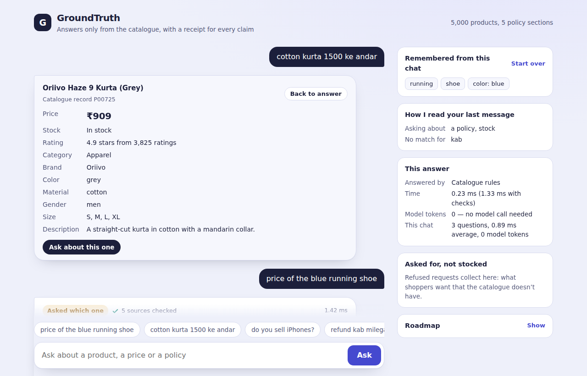
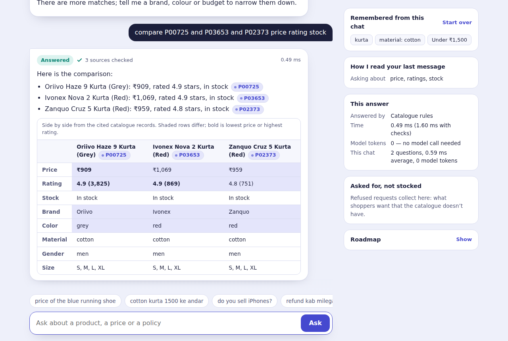
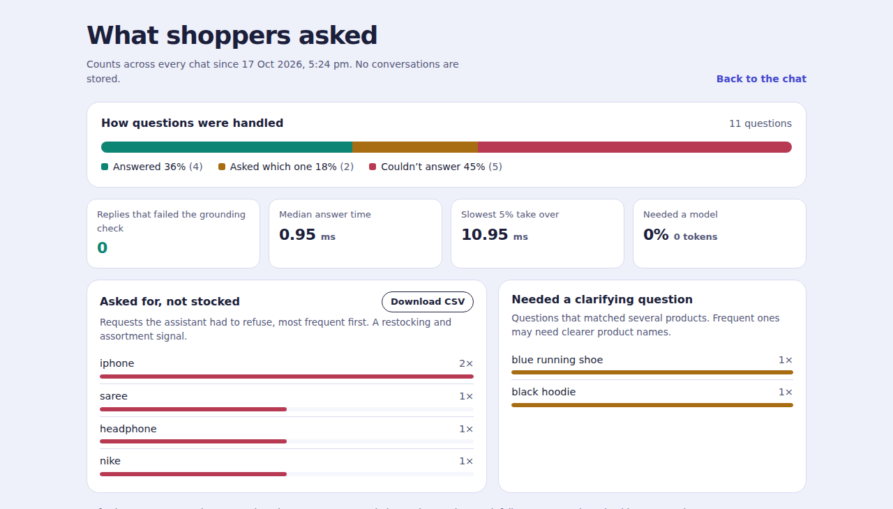

# Groundtruth Shop Assistant

A conversational shopping assistant over a fixed product catalogue that **cites every claim and refuses when the
catalogue can't support an answer**. Pure Python standard library, fully offline, zero LLM calls.

## Quick start

```bash
python data/generate_synthetic.py     # writes data/catalogue.jsonl, policy.txt, test_questions.jsonl (stand-ins)
python chat.py --meta                 # interactive CLI; --meta shows action, latency, token estimates
python evaluate.py --verbose          # scores + reports/summary.json + reports/query_report.csv
python -m unittest discover -s tests

python data/generate_hard.py          # adversarial questions (typos, negation, comparisons, multi-turn, ...)
python evaluate.py --questions data/hard_questions.jsonl --verbose
python data/generate_scale.py         # 5,000 messy products in data/scale/ (git-ignored)
python evaluate.py --catalogue data/scale/catalogue.jsonl --policy data/scale/policy.txt --questions data/scale/test_questions.jsonl

python data/generate_independent.py   # 60 shopper-style questions written independently of the code (data/scale/)
python data/generate_heldout.py       # 37 held-out questions never used for tuning (data/scale/)
python evaluate.py --catalogue data/scale/catalogue.jsonl --policy data/scale/policy.txt --questions data/scale/heldout_questions.jsonl --verbose

# with the provided offline models (see "Fallbacks" below)
python calibrate_semantic.py --embed-model PATH/TO/EMBEDDING_MODEL --catalogue PATH --policy PATH
python chat.py --meta --embed-model PATH/TO/EMBEDDING_MODEL --llm-model PATH/TO/INSTRUCT_MODEL
```

Swap in the real data with `--catalogue`, `--policy` and `--questions` on `chat.py` / `evaluate.py`.
`.jsonl`, `.json` and `.csv` catalogues are accepted (`id|product_id|sku`, `title|name`, `price`, `in_stock|stock_status`,
`rating`, `attributes` as a dict or JSON string). Policy text is split into sections on blank lines; a short first line
becomes the heading and the section id used in citations (`[policy:returns]`).

## How it works

Every reply sentence is assembled from catalogue fields or extracted verbatim from the policy text, then tagged with a
citation (`[P0012]`, `[policy:shipping]`). There is no free-form generation, so a price that isn't in the catalogue
cannot be produced.

| Situation | Behaviour |
|---|---|
| Question about one product that is unambiguous | Answer from catalogue fields |
| "the blue running shoe" when several match | **Clarify**: list candidates with their distinguishing attributes, no prices |
| Product/word not in the catalogue ("iPhones") | **Refuse** |
| Constraints nothing satisfies ("cotton shirts under ₹100") | **Refuse**, and name the closest cited alternative |
| Returns / shipping / warranty | Quote the matching policy sentences, cite the section |
| Policy question the document doesn't cover | **Refuse** |
| Follow-ups ("under ₹2,000, and I already said cotton", "what's the price?") | Session keeps type, filters, budget, last product |

Pipeline: `understand.py` (budget, size, attribute filters, intent, typo/Hinglish handling) -> [miss path only:
`semantic.py` embedding fallback -> `llm_normaliser.py` instruct-model normaliser] -> `index.py` (hard-constraint
filtering and ranking) -> `assistant.py` (answer / clarify / refuse). The attribute vocabulary (colours, brands, materials, ...)
is derived from the catalogue itself, so new catalogues need little configuration. Hinglish words and synonyms live in
`shopassistant/text.py` (`SYNONYMS`, `STOPWORDS`); extend them for the real queries.

## Web UI

```bash
python3 web.py                       # then open http://127.0.0.1:8000
python3 web.py --catalogue data/scale/catalogue.jsonl --policy data/scale/policy.txt --snapshot 2026-10-01
# retailer view: http://127.0.0.1:8000/insights
```









Standard library only and fully offline: no CDN scripts, no web fonts, no new dependencies. What it shows:

* **Receipts.** Every citation is a chip. Tap it and the answer card flips over to show the exact catalogue record,
  or the policy section with the sentence the answer used highlighted.
* **A check on every reply.** Each reply is re-run through the same independent grounding checker `evaluate.py`
  uses, and the result is shown next to it ("3 sources checked", or the problem if a check ever fails).
* **Remembered from this chat.** The filters and budget carried between turns, with a "Start over" control.
* **How I read your last message.** The product, filters, budget and unrecognised words picked out of the query.
* **This answer.** Which path answered it (rules, embedding or language model), time taken, and model tokens.
* **Asked for, not stocked.** Refused requests collected per chat, as a demand signal for the retailer.
* **Compare.** "Add to compare" on up to three product records, then one tap asks the assistant to compare them.
  The reply is the normal cited answer, plus a side-by-side table built from the cited records (differences shaded).
* **Prices as of a date.** The catalogue snapshot date is shown in the header and next to every price. Pass
  `--snapshot 2026-10-01`; otherwise the catalogue file's last-modified date is used and labelled as such.
* **Retailer view** at `/insights`: how questions were handled (answered, clarified, refused), replies that failed
  the grounding check (should stay 0), median and slow-tail latency, share needing a model, the most-requested items
  that aren't stocked (downloadable CSV), and the products that most often needed a clarifying question. Counts and
  short product labels only, in memory; full messages and session ids are never stored.
* A roadmap of features that are not built, labelled as such.

Light and dark mode, keyboard accessible, works on mobile, respects reduced motion. `tests/test_web.py` covers the
server.

## Fallbacks (provided models, miss path only)

The rule-based path answers most queries in under a millisecond with no model call. Only when it leaves product
words unrecognised do the optional fallbacks run, in this order:

1. **Embedding fallback** (`shopassistant/semantic.py`, `--embed-model`). Maps an unknown shopper word to the nearest
   catalogue product-type word ("jogging" -> "running"), never to a brand, model, colour or material. Above
   `map_threshold` it searches for that type and says so in the reply (`(I read "jogging" as "running".)`); between
   `alt_threshold` and `map_threshold` it refuses but lists cited alternatives; below, it refuses. It also retrieves
   policy sentences for policy questions phrased without policy keywords. Brands the shop doesn't carry are never
   mapped.
2. **LLM normaliser** (`shopassistant/llm_normaliser.py`, `--llm-model`). Asks the instruct model for JSON (type,
   filters, budget). Every field is checked against the catalogue's vocabulary, and a budget is accepted only if it is
   one of the shopper's own numbers. The model's text never reaches the shopper. Garbage output or a model error falls
   back to the rule-based answer.

**Thresholds must be calibrated**: `python calibrate_semantic.py --embed-model PATH` sets `map_threshold` just above
the best score of any listed word the shop doesn't sell (iphone, saree, laptop, ...), prints the evidence table and
writes `semantic_config.json`. Without that file the embedding fallback stays off. If `should_map_recall` is low, keep
it off rather than lowering the threshold by hand.

`evaluate.py` reports `path_share` (rules / semantic / llm) and the instruct model's real token counts
(`llm_tokens_real`), separately from the estimated context tokens.

## Evaluation sets

| Set | Written | What its score means |
|---|---|---|
| `data/test_questions.jsonl`, `data/hard_questions.jsonl`, `data/scale/test_questions.jsonl` | with the code | regression check only |
| `data/scale/independent_questions.jsonl` (`generate_independent.py`) | before the vocabulary fixes, from a shopper's view | was 0.827 before fixes; fixes were tuned on it, so now also a regression check |
| `data/scale/heldout_questions.jsonl` (`generate_heldout.py`) | after the fixes, never tuned on | the only generalisation estimate here: see CHANGES.md |

Expected answers in the last two are derived by plain filtering of the catalogue, never by calling the assistant.

## Scoring (`evaluate.py`)

The grounding checker re-derives what each citation licenses from the raw catalogue; it does not trust the assistant's
own bookkeeping.

* **Groundedness**: share of replies with no unsupported claim: citations resolve, every ₹ amount belongs to a cited
  product, cited policy section or the user's own query, other numbers appear in the cited sources, every product named
  is cited, every factual sentence carries a citation.
* **Helpfulness** (answerable questions): right product/policy cited, results satisfy the filters, required facts present.
* **Refusal accuracy**: answer / clarify / refuse matches the expected behaviour (confusion matrix in `summary.json`).
* **Hallucinated prices** each subtract 0.10 from the final score. `final = 0.35*grounded + 0.35*helpful + 0.30*refusal - 0.10*hallucinated`.
  These weights are my assumption; change them at the top of `evaluate.py` to match the official rubric.
* **Latency and token report**: per query in `reports/query_report.csv`, aggregates in `summary.json`. Token counts are
  estimates (about 4 characters per token) of what an LLM would be given (query plus cited sources) and produce; this
  assistant makes no LLM calls, so real cost is zero. Use `--price-in/--price-out` to price it as if it were.

## Serving many users

* `ShoppingAssistant` and `CatalogueIndex` are read-only after start-up (about 35 MB for 5,000 products), so one instance
  is safe to share across threads. Per-user state lives only in a `Session` (a few hundred bytes).
* `SessionStore` keeps sessions per user id: bounded (LRU), expiring (TTL), thread-safe, and serialises requests from the
  same user while different users run in parallel. Use `store.ask(assistant, user_id, query)`.
* Queries are answered from inverted indexes (no catalogue scan) with cached typo matching: about 0.5 ms per query,
  roughly 2,000 queries/s per process on 5,000 products (`python bench.py`; was about 290/s before optimisation).
* Python threads share one GIL, so more threads do not add throughput. Scale with worker processes (for example
  `uvicorn app:app --workers N`, one index copy each) rather than threads.
* Build with `measure_tokens=False` (the default) when serving; the token estimates exist for `evaluate.py` reports.

## Caveats

* Known gap: "do you ship to Dubai?" returns the shipping section but not necessarily the sentence about shipping outside
  India, because nothing links place names to "outside". Real policy wording will need a few such synonyms.

* The bundled 100-product catalogue and 63 questions are synthetic and were written together with the assistant, so
  the perfect score on them is a regression check, not evidence of accuracy. Expect real misses on the 5,000-product catalogue
  and the 150 hidden questions, mostly around vocabulary (synonyms, spellings, Hinglish), ambiguity thresholds, and policy wording.
* The fallbacks below were tested only with fake models (`tests/test_fallbacks.py`); their real effect on the score is
  unmeasured until they are run with the provided models.
* `evaluate.py` `load_cases` guesses the test-file field names; adjust once the real format is known.
